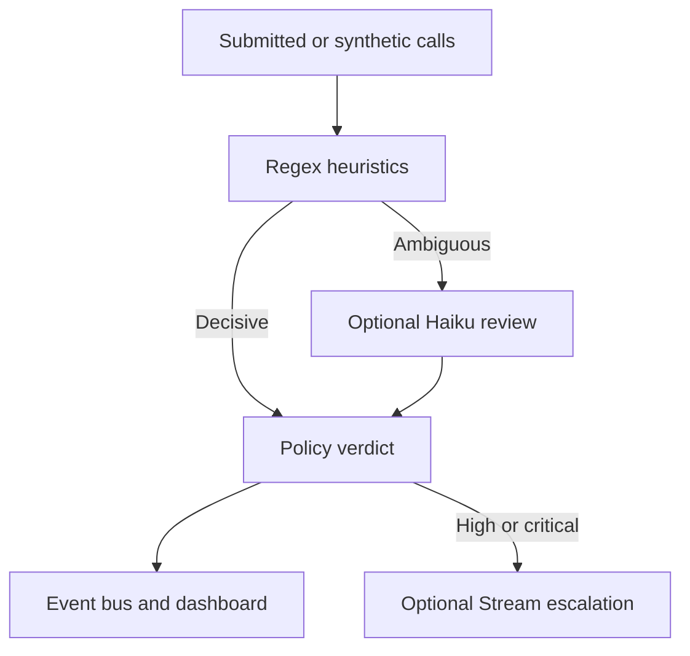

# Sentinel

**AI incident triage for agent tool calls and infrastructure alerts.**

> 🏆 **Winner — Best Use of VoiceOS & Hypescribe** at Hack-A-Stack 2026 (Santa Clara University, Endurance Track).
> 📄 [Devpost submission](https://devpost.com/software/sentinel-uheo94)

Sentinel is a hackathon prototype built with FastAPI and Next.js. It classifies synthetic agent tool-call events and evaluates Cisco infrastructure scenarios, then shows the evidence, proposed response, and escalation options in a shared dashboard.

---

## Demo

https://github.com/user-attachments/assets/ba54beee-12b3-4860-bb3e-7c32b1c30276

📄 **[Read the Devpost write-up](https://devpost.com/software/sentinel-uheo94)**

---

## The problem

Responders need enough context to decide what to do when an agent proposes a risky tool call or an infrastructure alert fires. Sentinel explores a shared workflow for reviewing the signals, recording a decision, and sharing incident context with other engineers.

---

## Two signal paths

### Layer 1 — Agent tool-call triage

Synthetic calls and calls submitted to `POST /api/intercept` are scored by a two-tier ranker. Regex heuristics handle clear cases and Claude Haiku reviews the ambiguous band when configured. The policy records a block verdict for critical events and a pending-human verdict for medium and high events. High and critical events can be posted to Stream when configured. Connecting this endpoint to a production agent proxy remains future work.

### Layer 2 — AI Factory operations

Sentinel ingests Cisco's AI Factory dataset (18 scenarios across performance, GPU placement, and failure detection), reads alerts, logs, and runbooks, and returns Cisco's required structured recommendation: action, target, reason category, confidence, evidence. Each recommendation also includes a plain-English reasoning sentence and a three-step on-call playbook with specific thresholds. The saved recommendations cover all 18 scenarios and pass Cisco's format and scenario-coverage validator. The validator checks required fields, known and unique scenario IDs, and nonempty evidence. Operational correctness requires separate scoring.

### Cross-layer escalation

Both layers share the dashboard, optional Stream incident feed, and MCP tools for incident lookup and human decisions. The Google Meet action returns a pre-created room link from `GOOGLE_MEET_LINK`. Room records and attendee lists are held in memory.

---

## How it works

Submitted and synthetic tool events flow through the ranker into a policy verdict and the in-memory event bus. The dashboard subscribes over server-sent events.



The Cisco advisor uses a separate recommendation path. Its explicit escalation action converts a recommendation into a high or critical incident card for the shared Stream channel. Responders can open the configured meeting link through the dashboard or MCP tools.

---

## Severity routing

| Tier | Surface | Sponsor |
|---|---|---|
| Low | Dashboard log and allow verdict | — |
| Medium | Dashboard with a pending-human verdict | — |
| High | Dashboard and optional Stream incident card | **Stream** |
| Critical | Dashboard block verdict, optional Stream card and Twilio call | **Stream**, **Twilio** |

VoiceOS can invoke incident and Cisco tools through MCP. The meeting action uses a configured Google Meet link. Tencent TRTC UserSig generation is also implemented.

**Anthropic Claude Haiku** powers the optional LLM tier. **Cisco's AI Factory dataset** supplies the infrastructure scenarios, alerts, logs, and runbooks.

---

## Demo flow

**Layer 1 — agent attack**
1. Dashboard streams intercepted events in real time
2. Click *Fire demo attack*. An agent attempts `DROP TABLE users`
3. Ranker scores the synthetic call 0.97 and records a Critical block verdict
4. Red banner appears with action buttons
5. Verdict propagates back to the dashboard and the Stream channel in real time

**Layer 2 — Cisco scenario**
1. Open the Cisco panel, pick scenario `perf-001`
2. Click *Evaluate with Sentinel*
3. Recommendation card returns: action, target, reason, confidence, evidence
4. Green *Next steps* card shows a three-step on-call playbook with thresholds
5. Click the ✓ *Cisco validator passed* pill to see the validator output
6. Click *Page on-call* — Cisco recommendation hits the Stream channel
7. Click *Open war room* to view the configured Google Meet link. Stream receives the link when configured.

**Voice**
- From VoiceOS, say *"what's the latest critical?"* — Sentinel reads the agent incident aloud
- Say *"evaluate scenario fail-005"* — Sentinel reads the Cisco recommendation aloud
- Same MCP server, both layers, hands-free

---

## Eval

The dashboard requests `/api/eval`, which runs the 36 labeled examples on the first request and caches the result for the process. The standalone harness runs the same examples. Evaluation treats a score of at least 0.5 as a positive prediction; the runtime policy assigns severity and verdict separately.

The heuristic-only column is reproducible without provider credentials. The Haiku column records the team's historical configured-model result and depends on the provider response. The small evaluation set demonstrates the prototype's behavior.

| Metric | Heuristics only | Historical + LLM (Haiku) |
|---|---|---|
| Precision | 100% | **100%** |
| Recall | 84% | **95%** |
| F1 | 0.91 | **0.97** |

The saved Layer 2 output passes format and coverage validation for all 18 scenarios.

Run agent eval from the repository root. The standalone command reads `ANTHROPIC_API_KEY` from the process environment. The server loads `backend/.env` when `app.main` starts.
```bash
cd backend
source .venv/bin/activate
python -m app.eval.harness
```

From a fresh repository-root terminal, run the Cisco format validator:
```bash
cd backend/cisco_data/ai_factory_hackathon_student
python validate_recommendation.py ../sentinel_recommendations.json --require-all
```

---

## Architecture decisions

**Two-tier ranker.** Decisive cases resolve through regex heuristics. Scores from 0.20 to 0.70 with at most one matched rule are eligible for Claude Haiku review. LLM outputs contain a score, category, and rationale and are cached by call fingerprint. When the API is unavailable or fails, the ranker returns the heuristic result.

**Shared response surfaces.** The Cisco advisor has its own model client and deterministic fallback. Its recommendations and the agent ranker's events share the dashboard and downstream collaboration tools. The advisor validates returned actions against the scenario's allowed action menu.

**MCP-first.** Sentinel exposes its operational surface as a Python MCP server with 8 tools (`incidents_lookup`, `incidents_decide`, `sentinel_status`, `cisco_scenarios`, `cisco_evaluate`, `warroom_create_meet`, `current_meet_link`, `warroom_invite`). VoiceOS picks it up via stdio and routes voice commands to our tools. Same protocol Sentinel defends.

**In-memory event bus.** 50k ring buffer with SSE streaming to the dashboard. Survives the demo. Would persist to Postgres in production.

**Optional integrations.** The local synthetic dashboard and heuristic evaluation run without provider credentials. Configured services enable model review, chat, calls, or the meeting link. The meeting action records attendees locally; the frontend email action opens a mail draft.

**No auth.** Anyone with dashboard access can decide. v2 work, called out in the pitch.

---

## Stack

| Layer | Tech |
|---|---|
| Backend | FastAPI, Pydantic, SSE, in-memory event bus |
| Ranker (Tier A) | regex heuristics, allow/denylists |
| Ranker (Tier B) | Claude Haiku via anthropic Python SDK |
| Cisco advisor | Heuristic routing by primary alert + LLM enrichment for reasoning + next steps |
| Eval | Python, JSON labels, exposed at `/api/eval` |
| Frontend | Next.js 16, Tailwind 4, React 19, TypeScript |
| Chat | stream-chat (server) + stream-chat-react v14 |
| Video | Google Meet (pre-provisioned room link); Tencent TRTC HMAC-SHA256 UserSig minting also implemented |
| Voice | Python `mcp[cli]` stdio server registered with VoiceOS Custom Integrations |
| Optional | twilio outbound calls (gracefully disabled without creds) |

---

## Running locally

### Backend
```bash
cd backend
python -m venv .venv && source .venv/bin/activate
pip install -r requirements.txt
cp .env.example .env  # fill in keys you have
uvicorn app.main:app --reload --port 8000
```
Synthetic traffic starts automatically.

### Frontend
```bash
cd frontend
npm install
npm run dev
```
Open http://localhost:3000.

### Optional sponsor creds (`backend/.env`)
```
ANTHROPIC_API_KEY=        # enables Tier B LLM ranker + Cisco reasoning
STREAM_API_KEY=           # enables incident chat panel
STREAM_API_SECRET=
TRTC_SDK_APP_ID=          # enables TRTC UserSig minting
TRTC_SDK_SECRET_KEY=
GOOGLE_MEET_LINK=         # war room Meet room
TWILIO_ACCOUNT_SID=       # optional outbound calls
TWILIO_AUTH_TOKEN=
TWILIO_FROM_NUMBER=
TWILIO_ONCALL_NUMBER=
```
Configure the integrations used in your demo. The backend reports availability, and unavailable actions show their setup requirements.

---

## Register Sentinel with VoiceOS

1. Ensure backend is running
2. In VoiceOS: *Settings → Integrations → Custom Integrations → Add*
3. Name: `Sentinel`
4. Launch command: `<absolute path>/backend/start.sh`

Then say:
- *"what's the latest critical?"*
- *"evaluate scenario perf-001"*
- *"release incident 42"*
- *"get the current war room link"*

---

## Project structure

```
backend/
  app/
    main.py                # FastAPI entrypoint
    interceptor.py         # tool call pipeline
    ranker.py              # composes heuristics + LLM
    heuristics.py          # Tier A rules
    llm_classifier.py      # Tier B Haiku
    policy.py              # score -> severity -> verdict
    event_bus.py           # in-memory pub/sub + SSE
    schemas.py             # Pydantic models
    mcp_server.py          # MCP stdio server for VoiceOS (8 tools)
    cisco/
      advisor.py           # Layer 2 Cisco scenario evaluator
      data.py              # scenario loader (CSV -> dict)
    escalation/
      stream.py            # Stream Chat client
      trtc.py              # TRTC UserSig minting
      google_meet.py       # Google Meet war room
      twilio_call.py       # optional outbound call
    eval/
      dataset.py           # labeled examples
      harness.py           # precision / recall / F1 report
    data/
      synthetic_traces.py  # mock traffic generator
  cisco_data/              # Cisco-provided dataset + validator
    ai_factory_hackathon_student/
      validate_recommendation.py
      data/public/evaluation_scenarios.csv
  start.sh                 # MCP launch script for VoiceOS

frontend/
  src/
    app/page.tsx           # dashboard
    lib/api.ts             # backend client
    lib/useEventStream.ts  # SSE hook
    components/
      WarRoom.tsx          # Google Meet war room modal + TTS
      StreamPanel.tsx      # embedded chat with filter tabs
      StreamFilterContext.tsx  # filter state for All/Agent/Cisco/Escalations
      IncidentMessage.tsx  # custom Stream message UI
      CiscoPanel.tsx       # Layer 2 scenario evaluator (+ inline ValidatorModal)
```

---

## What's next

- **Real JSON-RPC MCP proxy** in front of production agent fleets (current interceptor is schema-compatible)
- **Per-customer fine-tuned classifiers** trained on customer-specific agent traces
- **Fleet-wide firewall rule generation** from observed attacks across the agent fleet
- **Closed-loop remediation on Layer 2** — Sentinel executes its own recommendations after human approval, with rollback and audit
- **Role-based authorization and multi-party approval** for highest-stakes blocks
- **Deeper Cisco integration** — beyond evaluation, integrate with live Cisco infrastructure telemetry


---

## Team

Built at Hack-A-Stack 2026, Santa Clara University. Awarded **Best Use of VoiceOS & Hypescribe** by the sponsor judges.

- [Ankush Rai](https://github.com/akrai37)
- [Harshvardhan Garude](https://github.com/Harshvardhan-Garude)
- [Ray Hu](https://github.com/chu2)

## Links

- 📄 [Devpost](https://devpost.com/software/sentinel-uheo94)
- 🎥 [Demo video (YouTube)](https://www.youtube.com/watch?v=W2qMRsDp6cM)
